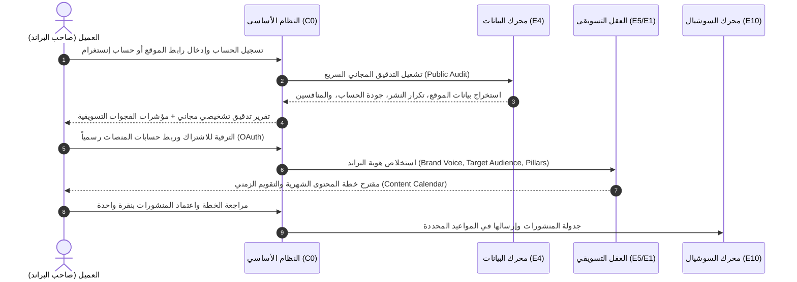

# 💼 سيناريوهات الاستخدام الرئيسية (Use Cases)
**تاريخ الصياغة:** 28 أكتوبر 2026

---

## 🎬 1. سيناريو رحلة تشخيص ونمو العلامة التجارية (Customer Growth Diagnosis — D-055)

يمثل هذا السيناريو المسار الأساسي لدخول أي عميل جديد للمنظومة:

---

## 📢 2. سيناريو إطلاق حملة تسويقية لمنتج جديد (Product Launch Campaign)
1. **الإدخال:** يقوم العميل بإدخال تفاصيل منتج جديد (اسم المنتج، المميزات، السعر، الجمهور، الهدف: مبيعات سريعة).
2. **المعالجة:**
   - يقوم محرك الشات والذكاء (E1) بصياغة استراتيجية حملة من 5 مراحل: (تشويق، إطلاق، آراء عملاء، عرض محدود، وتذكير أخير).
   - يقوم محرك توليد الصور (E3) بإنتاج صور تسويقية متناسقة مع أبعاد المنصات (إنستغرام، تويتر، تيك توك).
   - يقوم محرك الفيديو (E3) بتوليد سيناريو فيديو قصير (Reel) مع صوت تعليق عربي احترافي عبر محرك الصوت (E2).
3. **الاعتماد والجدولة:** تظهر الحملة في لوحة تحكم العميل مجمعة في جدول زمني للموافقة عليها بضغطة زر واحدة.

---

## 💬 3. سيناريو الرد الذكي والتقاط العملاء عبر واتساب (WhatsApp Lead Capture)
1. عميل مهتم يشاهد إعلاناً أو منشوراً ويضغط على رابط واتساب.
2. يستقبل محرك المحادثات (E11 OmniReply) الرسالة، ويفهم نية العميل بالذكاء الاصطناعي بناءً على ملف النشاط التجاري (Business Profile).
3. يقوم النظام بالرد فوراً بإجابة مخصصة، وعرض المنتجات أو تفاصيل الخدمة، وجمع بيانات العميل (الاسم، المدينة، الموعد المناسب) وتخزينها كـ Lead داخل الـ CRM (E12).
4. إرسال تنبيه فوري لصاحب النشاط التجاري عبر إشعار على الهاتف أو التيليجرام بوجود عميل مؤهل للإغلاق البيعي.
