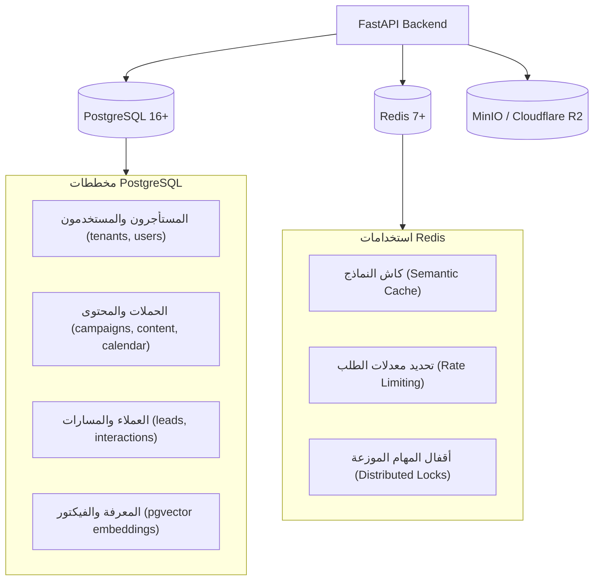

# 💾 معمارية البيانات والتكاملات (Data & Integrations)
**تاريخ الصياغة:** 28 أكتوبر 2026

---

## 🗄️ 1. معمارية طبقة البيانات (Data Plane Architecture)

تعتمد المنظومة على هيكل بيانات متين ومنخفض التكلفة التشغيلية:

---

## 🧱 1-ب. المخطط الفعلي المُنفَّذ حتى الآن (تُحدَّث من مراجعات المخطط)

> المصدر الوحيد للحقيقة هو هجرات `alembic/versions/`؛ هذا الجدول تلخيص لها عند `main` @ `e1e2fca` (الهجرة `0009`).

| الجدول | الأعمدة الأساسية | القيود المهمة | الهجرة |
|---|---|---|---|
| `tenants` | `id`, `slug` (UNIQUE، `^[a-z0-9](?:[a-z0-9-]{1,62}[a-z0-9])?$`), `name` | — | 0003 |
| `brands` | `id`, `owner_tenant_id` → tenants (RESTRICT), `slug`, `name` | UNIQUE (`owner_tenant_id`, `slug`) | 0003 |
| `brand_access_grants` | `id`, `brand_id` → brands (CASCADE), `grantee_tenant_id` → tenants (CASCADE), `role` ∈ {manager, viewer}, `granted_by_tenant_id`, `granted_at`, `revoked_at` | فهرس فريد **جزئي** على (`brand_id`, `grantee_tenant_id`) WHERE `revoked_at IS NULL` | 0003 |
| `social_connections` | `id`, `brand_id` → brands (CASCADE), `connected_by_tenant_id` → tenants (RESTRICT), `provider`, `provider_user_id`, `provider_user_name`, `encrypted_user_token`, `token_expires_at`, `granted_scopes`, `status`, `connected_at`, `last_synced_at`, `updated_at` | UNIQUE (`brand_id`, `provider`, `provider_user_id`) — نفس حساب Meta في علامتين = صفّان | 0001 → 0003 |
| `social_connection_pages` | `id`, `connection_id` → social_connections (CASCADE), `page_id`, `page_name`, `category`, `tasks`, `encrypted_page_token` (NULL = لا توكن), `is_selected`, حقول IG (`ig_user_id`, `ig_username`, `ig_name`, `ig_profile_picture_url`) | UNIQUE (`connection_id`, `page_id`)؛ CHECK: `is_selected = false OR encrypted_page_token IS NOT NULL` | 0001 → 0003 |
| `users`, `refresh_sessions` | ✅ (SPRINT-04/04.1، `main` @ `32c20cb`) مستخدم واحد ↔ مستأجر واحد؛ `users.is_active`؛ `refresh_sessions` (`token_hash` sha256، `expires_at`، `revoked_at`، `replaced_by`) — الإبطال أولاً ثم الإصدار | `/api/v1/auth/*` | 0004 |
| `social_connections.scopes_verified` | `BOOLEAN NOT NULL DEFAULT false`؛ backfill `true` حيث `granted_scopes::text <> '[]'` — يميّز «فارغ مؤكَّد» عن «مجهول» (درس 9) | — | 0005 |
| `content_items` | `id`, `brand_id` → brands (CASCADE), `created_by_tenant_id` → tenants (RESTRICT), `channel` ∈ {facebook_page, instagram, linkedin, x, tiktok} (0007؛ CHECK `ck_content_items_channel` — تخفيض 0007 **يؤرشف ثم يحذف** صفوف القنوات الثلاث الجديدة مع تبعاتها CASCADE)، `target_page_id` NULL, `status` ∈ {draft, pending_approval, approved, rejected, scheduled, **published, publish_failed**, archived}, `published_at` NULL (0006؛ CHECK `ck_content_items_published_at_iff_published`), `current_revision_id` → content_revisions (FK دائري يُضاف بعد الجدولين)، `scheduled_for` NULL، `created_at`/`updated_at` | CHECK `ck_content_items_status`؛ CHECK `ck_content_items_scheduled_for_iff_scheduled` (`status='scheduled' ⇔ scheduled_for IS NOT NULL`)؛ فهرس جزئي للمجدولة؛ الانتقالات CAS `UPDATE … WHERE status=:expected` | 0005 |
| `content_revisions` | `id`, `item_id` → content_items (CASCADE), `revision_no` ≥ 1, `body` (≤ 5000), `media_refs` JSONB, `provenance` JSONB (`{"kind":"human"}` أو `ai_generated` + provider/model/prompt_hash/generated_at/tokens/latency — عام `{kind, generated_at, prompt_version}` / خاص للمالك والمدير، D-066 ✅ SPRINT-07), `created_by_tenant_id`, `created_at` | UNIQUE (`item_id`, `revision_no`) `uq_content_revisions_item_no` (الترقيم تحت `SELECT … FOR UPDATE` على صف العنصر ✅ SPRINT-07 A-3)؛ CHECK `ck_content_revisions_body_length` | 0005 |
| `approval_events` | `id`, `item_id` → content_items (CASCADE), `revision_id` → content_revisions, `action` VARCHAR(32) ∈ {submitted, withdrawn, approved, rejected, scheduled, unscheduled, archived, **published, publish_failed, publish_cancelled**}, `actor_tenant_id`/`actor_user_id` **NULL مسموح فقط** للأحداث النظامية `published`/`publish_failed`, `note` NULL, `created_at` | CHECK `ck_approval_events_action`؛ CHECK `ck_approval_events_actor_required`؛ دليل D-055 القابل للتدقيق (من وافق/رفض/جدول أي مراجعة ومتى؛ هوية من أذن بالنشر في `publish_jobs.scheduled_by_*`) | 0005, 0006 |
| `publish_jobs` | `id`, `item_id` → content_items, `revision_id` → content_revisions, `brand_id`, `channel`, `target_page_id`, `run_at`, `status` ∈ {queued, leased, succeeded, failed, cancelled}, `attempt_count` ≥ 0, `max_attempts` ≥ 1 (default 3؛ **مصدر الحقيقة لكل مهمة** — القرار §3-2 في `SPRINT-07_REVIEW.md`), `next_attempt_at`, `lease_owner` (`hostname:pid`), `lease_until`, `last_error_class`, `external_post_id`, `permalink`, `scheduled_by_tenant_id`/`scheduled_by_user_id`, `created_at`/`updated_at` | **فهرس جزئي فريد** `uq_publish_jobs_active_item (item_id) WHERE status IN ('queued','leased')` — مهمة نشطة واحدة لكل عنصر؛ `ix_publish_jobs_status_run_at` للاستحقاق؛ CHECK `ck_publish_jobs_attempts`؛ الإيجار بـ`FOR UPDATE SKIP LOCKED` | 0006 |
| `publish_attempts` | `id`, `job_id` → publish_jobs (CASCADE), `attempt_no` ≥ 1, `started_at`, `finished_at` NULL, `outcome` NULL ∈ {succeeded, retryable_failure, permanent_failure, ambiguous}, `error_class`, `graph_error_code`/`graph_error_subcode`/`graph_trace_id`, `external_post_id` (IG: `creation_id` بعد الخطوة 1), `lease_owner` | UNIQUE (`job_id`, `attempt_no`) `uq_publish_attempts_job_no`؛ CHECK outcome؛ **الصف يُلتزم بـ`outcome NULL` قبل نداء Graph** — محاولة مفتوحة عند انتهاء الإيجار = نتيجة مبهمة | 0006 |

> **✅ F1 أُغلق (SPRINT-09 A-1، هجرة 0008):** `ck_content_items_published_at_iff_published` = `(status='published' AND published_at IS NOT NULL) OR (status='archived') OR (status NOT IN ('published','archived') AND published_at IS NULL)` — المؤرشَف يحتفظ بـ`published_at`؛ تخفيض 0008 يُصفّر `published_at` للمؤرشَف ثم يعيد القيد القديم.

**جداول M6 — WhatsApp Cloud API (هجرة 0009، `src/modules/whatsapp/`):**

| الجدول | الأعمدة الأساسية | القيود المهمة | الهجرة |
|---|---|---|---|
| `whatsapp_accounts` | `id`, `brand_id` → brands, `phone_number_id`, `waba_id`, `display_phone`, `encrypted_system_token`, `encrypted_app_secret`, `verify_token_hash`, `status` ∈ {active, disabled}, `created_by_user_id`, `created_at`/`updated_at` | UNIQUE `uq_whatsapp_accounts_phone_number_id`؛ UNIQUE `uq_whatsapp_accounts_brand_id` (حساب واحد لكل علامة — BYOK كامل، لا متغير بيئة) | 0009 |
| `wa_conversations` | `id`, `brand_id`, `account_id` → whatsapp_accounts, `wa_id` (رقم العميل — يُقنَّع `…7890` في الاستجابات), `profile_name`, `last_inbound_at`, `window_expires_at` (= +24h), `unread_count`, `status` ∈ {open, archived} | UNIQUE `uq_wa_conversations_account_wa_id`؛ keyset `last_inbound_at DESC, id DESC` | 0009 |
| `wa_messages` | `id`, `conversation_id`, `brand_id`, `direction` ∈ {inbound, outbound}, `wamid`, `client_message_id`, `kind` ∈ {text, template, image, unsupported}, `body`, `delivery_status` ∈ {received, queued, sent, delivered, read, failed, ambiguous}, `error_code`, `sent_by_user_id`, `reply_draft_id`, `platform_timestamp`, `created_at` | فهرس فريد **جزئي** `uq_wa_messages_wamid` و`uq_wa_messages_client_message_id`؛ CHECK `ck_wa_messages_outbound_has_actor` (صادر ⇒ `sent_by_user_id NOT NULL` — D-055) | 0009 |
| `wa_reply_drafts` | `id`, `conversation_id`, `brand_id`, `in_reply_to_message_id`, `suggested_body`, `final_body`, `status` ∈ {suggested, approved, edited, rejected, expired}, `provenance` JSONB (عام `{kind, generated_at, prompt_version, truncated}`؛ خاص `model/prompt_hash/tokens/credential_mode`), `decided_by_user_id`, `decided_at`, `rejection_reason`, `created_at` | CHECK `ck_wa_reply_drafts_decided_has_actor`؛ فهرس `ix_wa_reply_drafts_conversation_status` **(غير فريد — N5، يصبح فريداً جزئياً WHERE status='suggested' في 0010)** | 0009 |
| `wa_learning_signals` | `id`, `reply_draft_id`, `brand_id`, `signal` ∈ {approved_unchanged, approved_after_edit, rejected, expired}, `edit_distance_ratio`, `features` JSONB (`suggested_len, final_len, language, has_question, has_cta`), `prompt_version`, `model`, `credential_mode`, `created_at` | UNIQUE `uq_wa_learning_signals_reply_draft_id`؛ **لا عمود نصّ** (D-069) | 0009 |

> **⚠️ N1–N4 (مُثبَتة على PG في مراجعة SPRINT-09، تُغلق في SPRINT-10 A):** كتابات `approve`/`disable`/`failed` تُمحى بـrollback الطلب عند رفع HTTP (N1)؛ `connect_account` يرفض أي صف قائم ولو `disabled` وتضارب `phone_number_id` ⇒ 500 (N2)؛ `update_status_by_wamid` بلا `brand_id` ولا رتابة (N3)؛ ميزانية المحتوى لا تقرأ `wa_reply_drafts` (N4). التفصيل: `sprints/SPRINT-09_REVIEW.md` §4.

**واجهة سجلّ القنوات (M5، `src/modules/publishing/channels/`):** `ChannelRegistry(Mapping)` بـ`get(channel)` / `all()` / `activatable()` / `active()`؛ `get_registry()` بـ`lru_cache`؛ `ChannelDefinition{channel, display_name, provider, limits, capabilities, required_scopes, activation_requirements, media_rule, publisher_factory}`؛ `activation_status ∈ {active, not_configured}` **يُشتق من التعريف** (المنصّات الثلاث الجديدة `not_configured` حتى تُفعَّل بسبرنت خاص — مؤجَّل #16). `publish_jobs.channel` VARCHAR(16) **بلا CHECK** (السجلّ هو المتحقق).

**قرارات بيانات مرتبطة:** D-059 (النموذج)، D-060 (اختيار الصفحات)، D-061 (الهوية والاسم)، D-066 (`provenance` كسجل تكلفة/جودة أولي ورؤيته عام/خاص)، D-067 (عقد المزوّد ومسارا المفاتيح). **مؤجل:** `tenant_members` (عضوية متعددة داخل المستأجر) — انظر `DEFERRED_DECISIONS.md`.

---

### 1-ج. نقاط Meta Graph المستخدمة فعلياً (v26.0، `main` @ `e1e2fca`)

| النقطة | الطريقة | قناة الأسرار (D-064) | الاستخدام |
|---|---|---|---|
| `/oauth/access_token` | POST (جسم form) | `client_secret` في الجسم | تبادل الكود / long-lived |
| `/debug_token` | POST + `method=GET` | Bearer `app_id\|app_secret`؛ `input_token` في الجسم | تحقق `is_valid`/`app_id`/`user_id`/scopes/expiry |
| `/me` | GET | Bearer + `appsecret_proof` | هوية Meta (D-061) |
| `/me/accounts` | GET | Bearer + `appsecret_proof`؛ `paging.next` يُنقّى | قائمة الصفحات + IG + توكنات الصفحات |
| `/{page_id}/posts` | GET | Bearer توكن الصفحة + proof | B3 قراءة مباشرة (D-065)؛ الحقول `id,message,created_time,permalink_url,status_type,full_picture,is_published` (+`attachments` في SPRINT-06) |
| `/{ig_user_id}/media` | GET | Bearer توكن الصفحة + proof | B4 قراءة مباشرة؛ `instagram_basic` |
| `/{page_id}/feed` | POST (جسم form `message[, link]`) | Bearer توكن الصفحة + proof | M4 نشر منشور صفحة؛ `pages_manage_posts`؛ ثم `GET /{post_id}?fields=permalink_url` بأفضل جهد |
| `/{ig_user_id}/media` | POST (`image_url`, `caption`) | Bearer توكن الصفحة + proof | M4 الخطوة 1: حاوية IG ⇒ `creation_id` (يُحفظ في `publish_attempts.external_post_id` فلا تُنشأ حاوية ثانية عند الإعادة) |
| `/{ig_user_id}/media_publish` | POST (`creation_id`) | Bearer توكن الصفحة + proof | M4 الخطوة 2: النشر؛ `instagram_content_publish`؛ ثم `GET /{id}?fields=permalink` |

> **✅ F2 أُغلق (SPRINT-09 A-2، D-070):** `_request(..., idempotent=method.upper()=="GET")` — GET يحتفظ بحلقة الإعادة؛ POST عبر `_request_once_side_effecting` **مرة واحدة**: فشل قبل الإرسال (`ConnectError`/`ConnectTimeout`) ⇒ `MetaTransientError`؛ أي فشل بعده (5xx/`ReadTimeout`/كود 1/2) ⇒ `MetaAmbiguousError` ⇒ `PublishOutcome.ambiguous` بلا إعادة لاحقة (A2-I1).

**نقاط داخلية جديدة (M5):** `GET /api/v1/channels` و`GET /api/v1/channels/{channel}` (خلف `CurrentUser`، بلا دور علامة) ⇒ مصفوفة التفعيل: `activation_status`, `capabilities`, `required_scopes`, `activation_requirements[{key,title,owner,status,note}]` — لا سرّ ولا بيانات علامة.

**نقاط WhatsApp Cloud API (M6، `src/modules/whatsapp/client.py` فوق `core/http.py` — D-071، لا SDK):**

| النقطة | الطريقة | قناة الأسرار (D-064) | الاستخدام |
|---|---|---|---|
| `/{phone_number_id}?fields=display_phone_number,verified_name` | GET (يُعاد) | Bearer توكن النظام | تحقق الاعتماد عند `POST /account`؛ توكن مرفوض ⇒ 422 `whatsapp_credentials_invalid` ولا صفّ |
| `/{phone_number_id}/messages` (`type=text`) | POST **مرة واحدة** (D-070) | Bearer | إرسال نصّ حرّ داخل نافذة 24h — فاعل بشري إلزامي |
| `/{phone_number_id}/messages` (`type=template`) | POST مرة واحدة | Bearer | خارج النافذة — قالب معتمد في WABA (`^[a-z0-9_]+$`) |
| `/{phone_number_id}/messages` (`status=read`) | POST مرة واحدة | Bearer | `mark_read` |
| **وارد:** `GET/POST /api/v1/webhooks/whatsapp` | عام (بلا JWT) | `hub.verify_token` ضد `verify_token_hash`؛ `X-Hub-Signature-256` HMAC ضد `app_secret` العلامة | التحقق + استقبال `messages`/`statuses`؛ خطأ توقيع ⇒ 401 وصفر كتابة |

خريطة أكواد Meta ⇒ فئات داخلية: `{130429, 80007, 4, 80004}` ⇒ `rate_limited` (429 + `Retry-After`)؛ `{131026, 131047, 131051}` ⇒ `recipient` (422)؛ `{190, 10}` ⇒ `reauth_required` (409 — ويُعطَّل الحساب: **N1-b**)؛ `{1, 2, 131000}` ⇒ `transient` (503). لا نص Meta في أي استجابة أو سجل.

**نقاط داخلية M6** تحت `/api/v1/brands/{brand_id}/whatsapp`: `POST/GET/DELETE /account` (OWNER)، `GET /conversations` (keyset)، `GET /conversations/{id}/messages`، `POST …/read`، `POST …/archive`، `POST …/messages` (201؛ 200 عند تكرار `Idempotency-Key`؛ 202 عند `ambiguous`)، `POST …/template`، `POST …/suggest-reply` (201؛ 60/ساعة/علامة؛ **صفر** نداء Cloud API)، `POST /reply-drafts/{id}/approve` (200/202/422 `whatsapp_window_closed`)، `POST /reply-drafts/{id}/reject`. دليل الربط الحي خطوة بخطوة في `CURRENT_DIRECTIVE.md` (SPRINT-09 §6-12 — مُعتمَد في `sprints/SPRINT-09_REVIEW.md` §2).

> الحقول التي أوقفتها Meta في v3.3 على `/page/posts` (`caption, description, link, name, object_id, picture, source, type`) **غير مستخدمة**؛ البديل `attachments{…}`.

---

## 🌐 2. مصفوفة التكاملات الخارجية الرسمية

| المنصة الخارجية | بروتوكول الربط | الصلاحيات المطلوبة | التكلفة / القيود |
|---|---|---|---|
| **Meta (Instagram & Facebook)** | Graph API v21.0+ (OAuth 2.0) | `instagram_business_content_publish`, `pages_manage_posts` | تتطلب مراجعة التطبيق وتوثيق الشركة (App Review & Business Verification). |
| **TikTok** | Content Posting API (OAuth 2.0) | `video.publish`, `video.upload` | التطبيقات غير المدققة تنشر محتوى خاصاً فقط (SELF_ONLY) بحد أقصى 5 مستخدمين. |
| **LinkedIn** | Posts API (OAuth 2.0) | `w_member_social`, `w_organization_social` | تتطلب مراقبة ترويسات الإصدارات (`Linkedin-Version: YYYYMM`). |
| **X (Twitter)** | Twitter API v2 (OAuth 2.0) | `tweet.read`, `tweet.write` | تكلفة باهظة: $0.015 للمنشور النصي، و **$0.20** لمنشور الرابط. |
| **YouTube** | YouTube Data API v3 (OAuth 2.0) | `youtube.upload` | 100 وحدة رفع يومياً للتطبيقات غير المعتمدة، وتتطلب مراجعة أمنية لرفع الحصة. |
| **WhatsApp Business** | Cloud API (Meta) أو Web Session | Webhook + Send Message | تتطلب رقماً مخصصاً والالتزام بسياسات حظر الرسائل المزعجة (Opt-in). |
