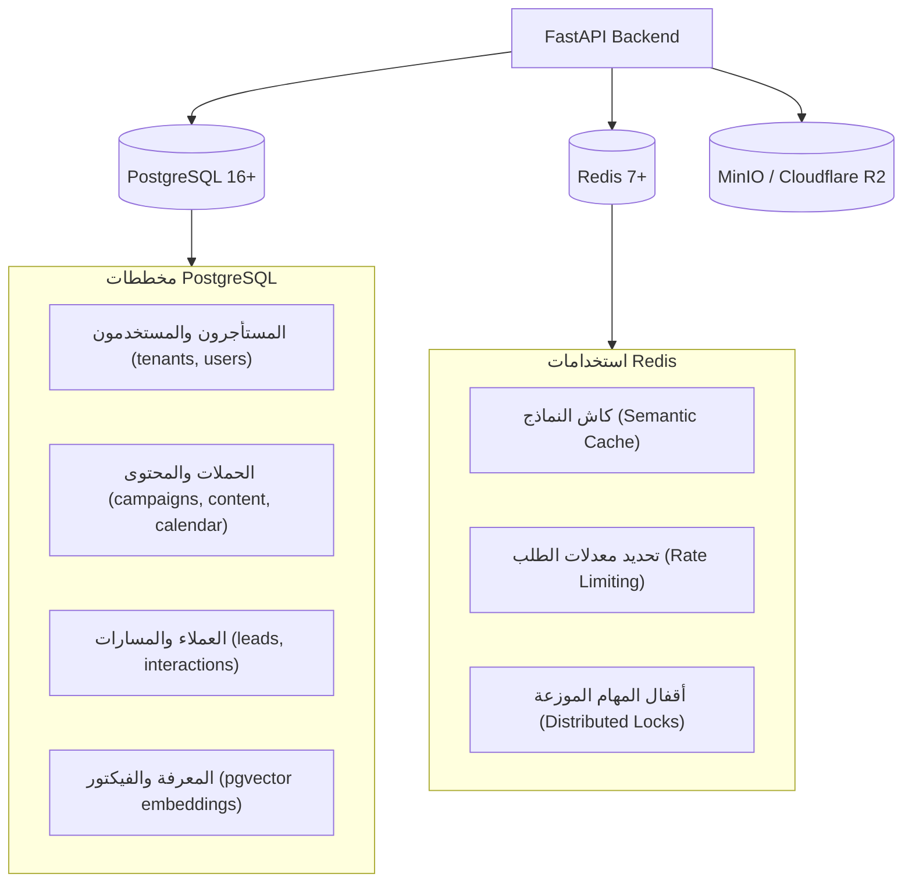

# 💾 معمارية البيانات والتكاملات (Data & Integrations)
**تاريخ الصياغة:** 28 أكتوبر 2026

---

## 🗄️ 1. معمارية طبقة البيانات (Data Plane Architecture)

تعتمد المنظومة على هيكل بيانات متين ومنخفض التكلفة التشغيلية:

---

## 🧱 1-ب. المخطط الفعلي المُنفَّذ حتى الآن (تُحدَّث من مراجعات المخطط)

> المصدر الوحيد للحقيقة هو هجرات `alembic/versions/`؛ هذا الجدول تلخيص لها عند `main` @ `20a18fc` (الهجرة `0005`).

| الجدول | الأعمدة الأساسية | القيود المهمة | الهجرة |
|---|---|---|---|
| `tenants` | `id`, `slug` (UNIQUE، `^[a-z0-9](?:[a-z0-9-]{1,62}[a-z0-9])?$`), `name` | — | 0003 |
| `brands` | `id`, `owner_tenant_id` → tenants (RESTRICT), `slug`, `name` | UNIQUE (`owner_tenant_id`, `slug`) | 0003 |
| `brand_access_grants` | `id`, `brand_id` → brands (CASCADE), `grantee_tenant_id` → tenants (CASCADE), `role` ∈ {manager, viewer}, `granted_by_tenant_id`, `granted_at`, `revoked_at` | فهرس فريد **جزئي** على (`brand_id`, `grantee_tenant_id`) WHERE `revoked_at IS NULL` | 0003 |
| `social_connections` | `id`, `brand_id` → brands (CASCADE), `connected_by_tenant_id` → tenants (RESTRICT), `provider`, `provider_user_id`, `provider_user_name`, `encrypted_user_token`, `token_expires_at`, `granted_scopes`, `status`, `connected_at`, `last_synced_at`, `updated_at` | UNIQUE (`brand_id`, `provider`, `provider_user_id`) — نفس حساب Meta في علامتين = صفّان | 0001 → 0003 |
| `social_connection_pages` | `id`, `connection_id` → social_connections (CASCADE), `page_id`, `page_name`, `category`, `tasks`, `encrypted_page_token` (NULL = لا توكن), `is_selected`, حقول IG (`ig_user_id`, `ig_username`, `ig_name`, `ig_profile_picture_url`) | UNIQUE (`connection_id`, `page_id`)؛ CHECK: `is_selected = false OR encrypted_page_token IS NOT NULL` | 0001 → 0003 |
| `users`, `refresh_sessions` | ✅ (SPRINT-04/04.1، `main` @ `32c20cb`) مستخدم واحد ↔ مستأجر واحد؛ `users.is_active`؛ `refresh_sessions` (`token_hash` sha256، `expires_at`، `revoked_at`، `replaced_by`) — الإبطال أولاً ثم الإصدار | `/api/v1/auth/*` | 0004 |
| `social_connections.scopes_verified` | `BOOLEAN NOT NULL DEFAULT false`؛ backfill `true` حيث `granted_scopes::text <> '[]'` — يميّز «فارغ مؤكَّد» عن «مجهول» (درس 9) | — | 0005 |
| `content_items` | `id`, `brand_id` → brands (CASCADE), `created_by_tenant_id` → tenants (RESTRICT), `channel` ∈ {instagram, facebook_page}, `target_page_id` NULL, `status` ∈ {draft, pending_approval, approved, rejected, scheduled, archived}, `current_revision_id` → content_revisions (FK دائري يُضاف بعد الجدولين)، `scheduled_for` NULL، `created_at`/`updated_at` | CHECK `ck_content_items_status`؛ CHECK `ck_content_items_scheduled_for_iff_scheduled` (`status='scheduled' ⇔ scheduled_for IS NOT NULL`)؛ فهرس جزئي للمجدولة؛ الانتقالات CAS `UPDATE … WHERE status=:expected` | 0005 |
| `content_revisions` | `id`, `item_id` → content_items (CASCADE), `revision_no` ≥ 1, `body` (≤ 5000), `media_refs` JSONB, `provenance` JSONB (`{"kind":"human"}` أو `ai_generated` + provider/model/prompt_hash/generated_at/tokens/latency — الرؤية تُفصل عام/خاص في SPRINT-07), `created_by_tenant_id`, `created_at` | UNIQUE (`item_id`, `revision_no`) `uq_content_revisions_item_no` (⚠️ الترقيم يحتاج قفل صف العنصر — SPRINT-07 A-3)؛ CHECK `ck_content_revisions_body_length` | 0005 |
| `approval_events` | `id`, `item_id` → content_items (CASCADE), `revision_id` → content_revisions, `action` ∈ {submitted, withdrawn, approved, rejected, scheduled, unscheduled, archived}, `actor_tenant_id`, `note` NULL, `created_at` | CHECK `ck_approval_events_action`؛ دليل D-055 القابل للتدقيق (من وافق/رفض أي مراجعة ومتى) | 0005 |

**قرارات بيانات مرتبطة:** D-059 (النموذج)، D-060 (اختيار الصفحات)، D-061 (الهوية والاسم)، D-066 (`provenance` كسجل تكلفة/جودة أولي ورؤيته عام/خاص)، D-067 (عقد المزوّد ومسارا المفاتيح). **مؤجل:** `tenant_members` (عضوية متعددة داخل المستأجر) — انظر `DEFERRED_DECISIONS.md`.

---

### 1-ج. نقاط Meta Graph المستخدمة فعلياً (v26.0، `main` @ `d026a2e`)

| النقطة | الطريقة | قناة الأسرار (D-064) | الاستخدام |
|---|---|---|---|
| `/oauth/access_token` | POST (جسم form) | `client_secret` في الجسم | تبادل الكود / long-lived |
| `/debug_token` | POST + `method=GET` | Bearer `app_id\|app_secret`؛ `input_token` في الجسم | تحقق `is_valid`/`app_id`/`user_id`/scopes/expiry |
| `/me` | GET | Bearer + `appsecret_proof` | هوية Meta (D-061) |
| `/me/accounts` | GET | Bearer + `appsecret_proof`؛ `paging.next` يُنقّى | قائمة الصفحات + IG + توكنات الصفحات |
| `/{page_id}/posts` | GET | Bearer توكن الصفحة + proof | B3 قراءة مباشرة (D-065)؛ الحقول `id,message,created_time,permalink_url,status_type,full_picture,is_published` (+`attachments` في SPRINT-06) |
| `/{ig_user_id}/media` | GET | Bearer توكن الصفحة + proof | B4 قراءة مباشرة؛ `instagram_basic` |

> الحقول التي أوقفتها Meta في v3.3 على `/page/posts` (`caption, description, link, name, object_id, picture, source, type`) **غير مستخدمة**؛ البديل `attachments{…}`.

---

## 🌐 2. مصفوفة التكاملات الخارجية الرسمية

| المنصة الخارجية | بروتوكول الربط | الصلاحيات المطلوبة | التكلفة / القيود |
|---|---|---|---|
| **Meta (Instagram & Facebook)** | Graph API v21.0+ (OAuth 2.0) | `instagram_business_content_publish`, `pages_manage_posts` | تتطلب مراجعة التطبيق وتوثيق الشركة (App Review & Business Verification). |
| **TikTok** | Content Posting API (OAuth 2.0) | `video.publish`, `video.upload` | التطبيقات غير المدققة تنشر محتوى خاصاً فقط (SELF_ONLY) بحد أقصى 5 مستخدمين. |
| **LinkedIn** | Posts API (OAuth 2.0) | `w_member_social`, `w_organization_social` | تتطلب مراقبة ترويسات الإصدارات (`Linkedin-Version: YYYYMM`). |
| **X (Twitter)** | Twitter API v2 (OAuth 2.0) | `tweet.read`, `tweet.write` | تكلفة باهظة: $0.015 للمنشور النصي، و **$0.20** لمنشور الرابط. |
| **YouTube** | YouTube Data API v3 (OAuth 2.0) | `youtube.upload` | 100 وحدة رفع يومياً للتطبيقات غير المعتمدة، وتتطلب مراجعة أمنية لرفع الحصة. |
| **WhatsApp Business** | Cloud API (Meta) أو Web Session | Webhook + Send Message | تتطلب رقماً مخصصاً والالتزام بسياسات حظر الرسائل المزعجة (Opt-in). |
