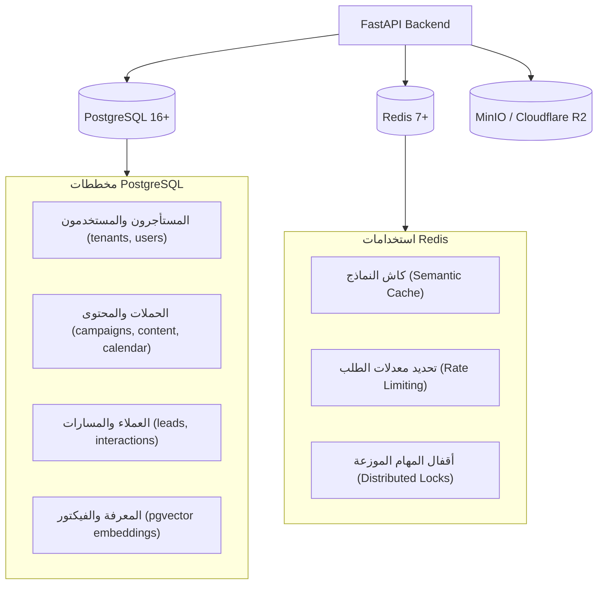

# 💾 معمارية البيانات والتكاملات (Data & Integrations)
**تاريخ الصياغة:** 28 أكتوبر 2026

---

## 🗄️ 1. معمارية طبقة البيانات (Data Plane Architecture)

تعتمد المنظومة على هيكل بيانات متين ومنخفض التكلفة التشغيلية:

---

## 🌐 2. مصفوفة التكاملات الخارجية الرسمية

| المنصة الخارجية | بروتوكول الربط | الصلاحيات المطلوبة | التكلفة / القيود |
|---|---|---|---|
| **Meta (Instagram & Facebook)** | Graph API v21.0+ (OAuth 2.0) | `instagram_business_content_publish`, `pages_manage_posts` | تتطلب مراجعة التطبيق وتوثيق الشركة (App Review & Business Verification). |
| **TikTok** | Content Posting API (OAuth 2.0) | `video.publish`, `video.upload` | التطبيقات غير المدققة تنشر محتوى خاصاً فقط (SELF_ONLY) بحد أقصى 5 مستخدمين. |
| **LinkedIn** | Posts API (OAuth 2.0) | `w_member_social`, `w_organization_social` | تتطلب مراقبة ترويسات الإصدارات (`Linkedin-Version: YYYYMM`). |
| **X (Twitter)** | Twitter API v2 (OAuth 2.0) | `tweet.read`, `tweet.write` | تكلفة باهظة: $0.015 للمنشور النصي، و **$0.20** لمنشور الرابط. |
| **YouTube** | YouTube Data API v3 (OAuth 2.0) | `youtube.upload` | 100 وحدة رفع يومياً للتطبيقات غير المعتمدة، وتتطلب مراجعة أمنية لرفع الحصة. |
| **WhatsApp Business** | Cloud API (Meta) أو Web Session | Webhook + Send Message | تتطلب رقماً مخصصاً والالتزام بسياسات حظر الرسائل المزعجة (Opt-in). |
