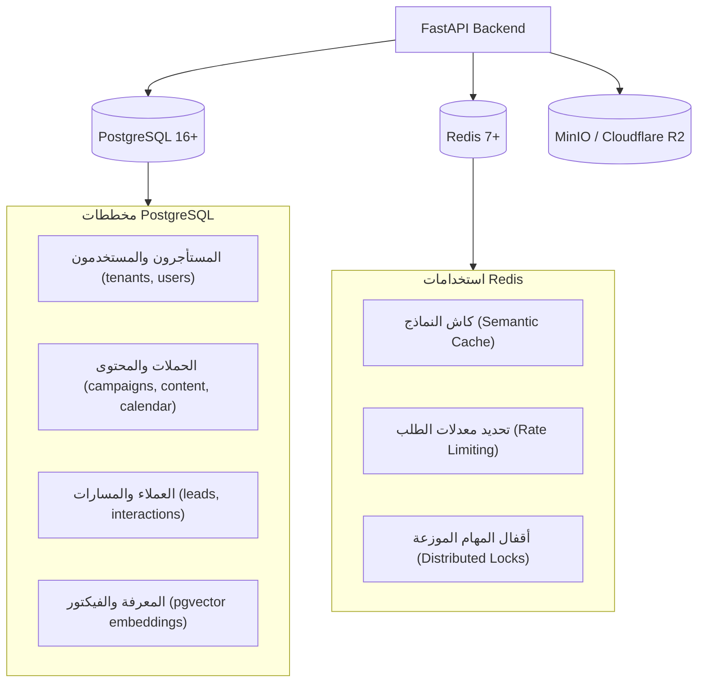

# 💾 معمارية البيانات والتكاملات (Data & Integrations)
**تاريخ الصياغة:** 28 أكتوبر 2026

---

## 🗄️ 1. معمارية طبقة البيانات (Data Plane Architecture)

تعتمد المنظومة على هيكل بيانات متين ومنخفض التكلفة التشغيلية:

---

## 🧱 1-ب. المخطط الفعلي المُنفَّذ حتى الآن (تُحدَّث من مراجعات المخطط)

> المصدر الوحيد للحقيقة هو هجرات `alembic/versions/`؛ هذا الجدول تلخيص لها عند `main` @ `8f1f246` (الهجرة `0003`).

| الجدول | الأعمدة الأساسية | القيود المهمة | الهجرة |
|---|---|---|---|
| `tenants` | `id`, `slug` (UNIQUE، `^[a-z0-9](?:[a-z0-9-]{1,62}[a-z0-9])?$`), `name` | — | 0003 |
| `brands` | `id`, `owner_tenant_id` → tenants (RESTRICT), `slug`, `name` | UNIQUE (`owner_tenant_id`, `slug`) | 0003 |
| `brand_access_grants` | `id`, `brand_id` → brands (CASCADE), `grantee_tenant_id` → tenants (CASCADE), `role` ∈ {manager, viewer}, `granted_by_tenant_id`, `granted_at`, `revoked_at` | فهرس فريد **جزئي** على (`brand_id`, `grantee_tenant_id`) WHERE `revoked_at IS NULL` | 0003 |
| `social_connections` | `id`, `brand_id` → brands (CASCADE), `connected_by_tenant_id` → tenants (RESTRICT), `provider`, `provider_user_id`, `provider_user_name`, `encrypted_user_token`, `token_expires_at`, `granted_scopes`, `status`, `connected_at`, `last_synced_at`, `updated_at` | UNIQUE (`brand_id`, `provider`, `provider_user_id`) — نفس حساب Meta في علامتين = صفّان | 0001 → 0003 |
| `social_connection_pages` | `id`, `connection_id` → social_connections (CASCADE), `page_id`, `page_name`, `category`, `tasks`, `encrypted_page_token` (NULL = لا توكن), `is_selected`, حقول IG (`ig_user_id`, `ig_username`, `ig_name`, `ig_profile_picture_url`) | UNIQUE (`connection_id`, `page_id`)؛ CHECK: `is_selected = false OR encrypted_page_token IS NOT NULL` | 0001 → 0003 |
| `users`, `refresh_sessions` | *(SPRINT-04 — قيد التنفيذ)* مستخدم واحد ↔ مستأجر واحد في هذه المرحلة؛ `refresh_sessions.token_hash` = sha256 فقط | — | 0004 |

**قرارات بيانات مرتبطة:** D-059 (النموذج)، D-060 (اختيار الصفحات)، D-061 (الهوية والاسم). **مؤجل:** `tenant_members` (عضوية متعددة داخل المستأجر) — انظر `DEFERRED_DECISIONS.md`.

---

## 🌐 2. مصفوفة التكاملات الخارجية الرسمية

| المنصة الخارجية | بروتوكول الربط | الصلاحيات المطلوبة | التكلفة / القيود |
|---|---|---|---|
| **Meta (Instagram & Facebook)** | Graph API v21.0+ (OAuth 2.0) | `instagram_business_content_publish`, `pages_manage_posts` | تتطلب مراجعة التطبيق وتوثيق الشركة (App Review & Business Verification). |
| **TikTok** | Content Posting API (OAuth 2.0) | `video.publish`, `video.upload` | التطبيقات غير المدققة تنشر محتوى خاصاً فقط (SELF_ONLY) بحد أقصى 5 مستخدمين. |
| **LinkedIn** | Posts API (OAuth 2.0) | `w_member_social`, `w_organization_social` | تتطلب مراقبة ترويسات الإصدارات (`Linkedin-Version: YYYYMM`). |
| **X (Twitter)** | Twitter API v2 (OAuth 2.0) | `tweet.read`, `tweet.write` | تكلفة باهظة: $0.015 للمنشور النصي، و **$0.20** لمنشور الرابط. |
| **YouTube** | YouTube Data API v3 (OAuth 2.0) | `youtube.upload` | 100 وحدة رفع يومياً للتطبيقات غير المعتمدة، وتتطلب مراجعة أمنية لرفع الحصة. |
| **WhatsApp Business** | Cloud API (Meta) أو Web Session | Webhook + Send Message | تتطلب رقماً مخصصاً والالتزام بسياسات حظر الرسائل المزعجة (Opt-in). |
