# 🏛️ النظرة الشاملة لمعمارية المنظومة (System Overview)
**تاريخ الاعتماد:** 28 أكتوبر 2026  
**المرجعية:** دستور العائلة F0 وقرارات المعمارية D-012 إلى D-016

---

## 🧭 1. الفلسفة المعمارية الحاكمة

تعتمد المنظومة على مبدأ معماري صلب يحمي المشروع من التقادم أو الحاجة إلى إعادة البناء:

> **Static Charter, Independent Services, Additive Assembly, Governed Evolution**  
> (ميثاق ثابت، خدمات مستقلة، تجميع تراكمي، وتطور محكوم)

تتكون المنظومة من **نواة تنسيقية موحدة صغيرة (Core C0)** محاطة بـ **12 محركاً متخصصاً (Engines E1 - E12)** يتصل كل منها بالنواة حصرياً عبر واجهات برمجية وعقود بيانات موحدة (Unified Envelopes):

```mermaid
flowchart TD
    subgraph Clients["بوابات الوصول"]
        Web["لوحة تحكم الويب (Next.js 14)"]
        API["بوابة الـ API الخارجية"]
        Mobile["واجهة الجوال / PWA"]
    end

    subgraph Core["نواة التنسيق والخدمات المشتركة (C0 & Foundation)"]
        Auth["المصادقة والصلاحيات (RBAC)"]
        Tenancy["عزل المستأجرين (Multi-tenancy)"]
        Router["موجه النوايا والخطط (Orchestrator)"]
        Envelope["محرك المغلف الموحد (libs/envelope)"]
        Explog["سجل الخبرة المشفر (libs/explog)"]
        Temporal["محرك التنفيذ المتين (Temporal Server)"]
    end

    subgraph Engines["المحركات التخصصية المستقلة (Domain Engines)"]
        E1["E1: محرك الشات والنصوص"]
        E2["E2: محرك الصوت والمكالمات"]
        E3["E3: محرك الصور والفيديو"]
        E4["E4: محرك البيانات والاستخراج"]
        E5["E5: محرك المعرفة واسترجاعها"]
        E6["E6: محرك تشغيل النماذج"]
        E7["E7: مصنع تدريب النماذج"]
        E8["E8: محرك التقييم وضبط الجودة"]
        E9["E9: محرك التعلم والتطوير"]
        E10["E10: محرك الجدولة والنشر"]
        E11["E11: محرك واتساب والتواصل"]
        E12["E12: محرك العملاء والـ CRM"]
    end

    subgraph DataPlane["طبقة تخزين وإدارة البيانات"]
        Postgres[(PostgreSQL 16+)]
        Redis[(Redis Caching & State)]
        Storage[(S3-compatible Media Storage)]
    end

    Clients --> Core
    Core --> Engines
    Engines --> DataPlane
```

---

## 🔒 2. ميثاق الخدمة الموحد (Service Charter F1)

يلتزم كل محرك من المحركات بالمعايير الصارمة التالية:
1. **الاستقلالية المنطقية:** يمتلك كل محرك منطق العمل الخاص به (Domain Logic) ولا يتدخل في شؤون المحركات الأخرى.
2. **عقد المغلف الموحد (The Envelope):**
   - كل طلب داخلي يبدأ بـ `RequestEnvelope` يحمل هوية المستأجر (`tenant_id`)، وهوية المستخدم، والطلب المحدد.
   - كل استجابة تُغلف بـ `ResponseEnvelope` تحمل النتيجة، وتصنيف الأخطاء من الـ 12 فئة المغلقة، وسجل استهلاك الموارد بدقة.
3. **التنفيذ المتين عبر Temporal (Durable Execution):**
   - أي عملية تستغرق وقتاً طويلاً أو تتضمن خطوات متعددة أو تحتاج إلى موافقة العميل تُبنى كـ Temporal Workflow لضمان استمرارية الحالة ومقاومة الأعطال.
