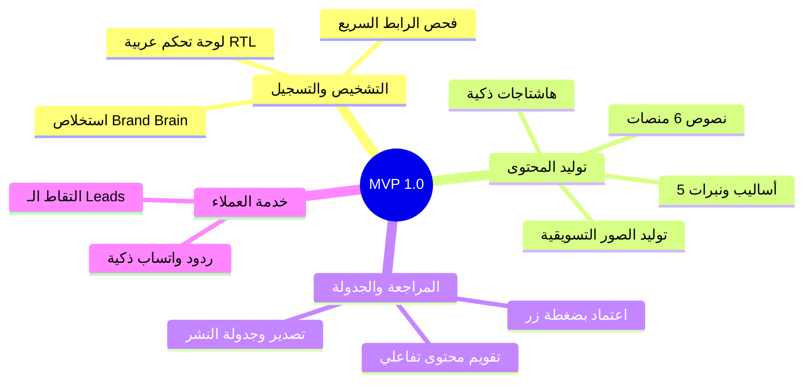

# 🚀 تعريف النسخة الأولى القابلة للاستخدام (MVP Definition)
**تاريخ الاعتماد:** 28 أكتوبر 2026  
**الهدف:** إطلاق نسخة سريعة ومستقرة، تحقق قيمة تسويقية حقيقية للعميل، وتولد إيرادات مبكرة، دون تعقيد تشغيلي.

---

## 📦 1. ميزات النسخة الأولى (MVP Feature Set)

1. **بوابة التشخيص وتسجيل النشاط التجاري (Brand Onboarding):**
   - يدخل العميل رابط موقعه أو حسابه الاجتماعي.
   - يقوم النظام بتشخيص سريع واستخلاص "عقل العلامة التجارية" (اسم النشاط، طبيعة العمل، الجمهور، والأسلوب).
2. **مولد المحتوى الذكي متعدد المنصات (Multi-Platform Content Generator):**
   - توليد منشورات فورية لـ (فيسبوك، إنستغرام، لينكدإن، تويتر/X، وتيك توك).
   - اختيار النبرة المناسبة (رسمي، فكاهي، حماسي، إقناعي) ودعم اللهجات العربية.
   - اقتراح صور تسويقية مناسبة للمنشور عبر محرك الصور.
3. **تقويم المحتوى والموافقة البشرية (Content Calendar & Approval):**
   - عرض الخطة الأسبوعية والشهرية على شكل تقويم منظم.
   - زر "اعتماد ونشر/جدولة" مع إمكانية التعديل السريع للنص.
4. **الرد الذكي عبر واتساب (WhatsApp Assistant):**
   - ربط رقم النشاط التجاري للرد الفوري على أسئلة العملاء والتقاط بياناتهم كـ Leads.
5. **نظام الاشتراكات والرصيد الأساسي:**
   - نظام رصيد (Credits) شفاف، يدعم الدفع المحلي (فودافون كاش / انستاباي) و USDT.

---

## 🚫 2. ما تم استبعاده وتأجيله عن الـ MVP
- الاتصال الصوتي الهاتفي الحي (مؤجل إلى المرحلة 3).
- توليد الفيديو الثقيل ثلاثي الأبعاد عبر خوادم GPU محلية (مؤجل إلى المرحلة 2).
- مستودع التحليلات الضخم عبر ClickHouse.
