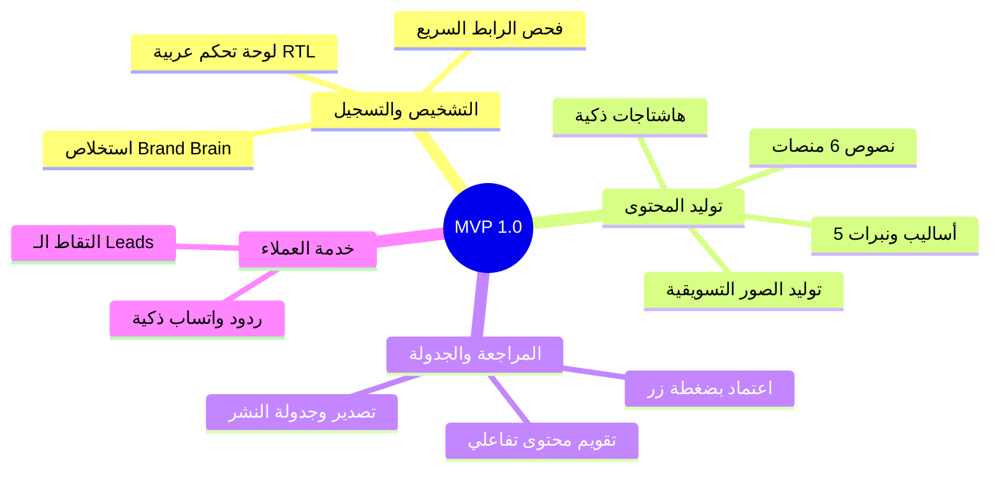

# 🚀 تعريف النسخة الأولى القابلة للاستخدام (MVP Definition)
**تاريخ الاعتماد:** 28 أكتوبر 2026  
**الهدف:** إطلاق نسخة سريعة ومستقرة، تحقق قيمة تسويقية حقيقية للعميل، وتولد إيرادات مبكرة، دون تعقيد تشغيلي.

---

## 📦 1. ميزات النسخة الأولى (MVP Feature Set)

1. **بوابة التشخيص وتسجيل النشاط التجاري (Brand Onboarding):**
   - يدخل العميل رابط موقعه أو حسابه الاجتماعي.
   - يقوم النظام بتشخيص سريع واستخلاص "عقل العلامة التجارية" (اسم النشاط، طبيعة العمل، الجمهور، والأسلوب).
2. **مولد المحتوى الذكي متعدد المنصات (Multi-Platform Content Generator):**
   - توليد منشورات فورية لـ (فيسبوك، إنستغرام، لينكدإن، تويتر/X، وتيك توك).
   - اختيار النبرة المناسبة (رسمي، فكاهي، حماسي، إقناعي) ودعم اللهجات العربية.
   - اقتراح صور تسويقية مناسبة للمنشور عبر محرك الصور.
3. **تقويم المحتوى والموافقة البشرية (Content Calendar & Approval):**
   - عرض الخطة الأسبوعية والشهرية على شكل تقويم منظم.
   - زر "اعتماد ونشر/جدولة" مع إمكانية التعديل السريع للنص.
4. **الرد الذكي عبر واتساب (WhatsApp Assistant) — M6 ✅ (`main` @ `e1e2fca`):**
   - ربط رقم النشاط التجاري (Cloud API، BYOK)، صندوق وارد موحَّد، ردّ مقترح بالذكاء الاصطناعي **لا يُرسَل إلا بموافقة بشرية** (D-055) — لا «ردّ فوري» آلي في V1؛ التقاط الـLeads في M7/M8.
5. **طبقة الباقات والحدود وتفعيل الاشتراك (D-073) — SPRINT-11 A:**
   - `brand_entitlements` (خطة + حدود رقمية: رموز/يوم، منشورات/شهر، محادثات واتساب، مقاعد) + `entitlement_events` بفاعل بشري؛ التفعيل **يدوي** من مالك المنصة في V1.
   - **خارج الـMVP (مؤجَّل #18):** بوابة الدفع المحلي (فودافون كاش / إنستاباي) وUSDT ونظام رصيد مُحاسَب آلياً — تُعاد عند ≥ 3 عملاء يدفعون يدوياً.
   - **التوافق مع خريطة M1–M10:** هذا البند لا يُنشئ محطة جديدة؛ يُنفَّذ كجزء A من SPRINT-11 (قبل M8) وتظهر واجهته في M10. (صُحِّح 2026-10-31 بعد ملاحظة المالك — كان النص السابق يدرج الدفع في الـMVP خلافاً للخريطة.)

---

## 🚫 2. ما تم استبعاده وتأجيله عن الـ MVP
- الاتصال الصوتي الهاتفي الحي (مؤجل إلى المرحلة 3).
- توليد الفيديو الثقيل ثلاثي الأبعاد عبر خوادم GPU محلية (مؤجل إلى المرحلة 2).
- مستودع التحليلات الضخم عبر ClickHouse.
