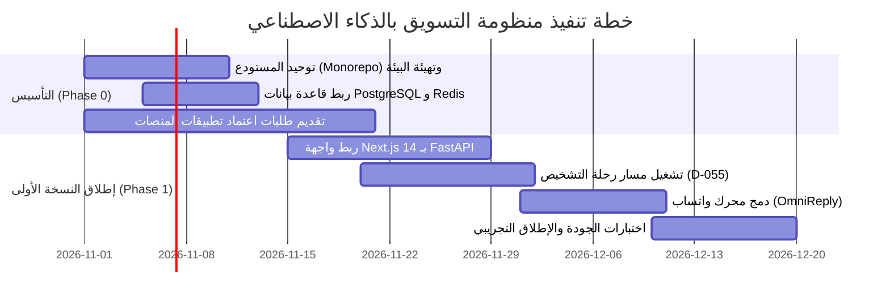

# 🛠️ خطة التنفيذ المنهجية (Implementation Plan)
**تاريخ الصياغة:** 28 أكتوبر 2026

---

## 📅 1. خطة العمل الموزعة على حزم (Work Packages)

### الحزمة 1: التأسيس والبنية التحتية الموحدة (Weeks 1 - 2)
- دمج الكود في المستودع الموحد `platform/` المعتمد في `ult_agent_agent`.
- إعداد ملفات `docker-compose.yml` لتشغيل (FastAPI, PostgreSQL 16, Redis, Temporal).
- تفعيل إدارة الهجرة الآلية لقواعد البيانات باستخدام Alembic.

### الحزمة 2: ربط الواجهة والتشخيص الذكي (Weeks 3 - 4)
- ربط شاشات الواجهة العربية بـ FastAPI Endpoints الموحدة بدلاً من الاتصال المباشر القديم.
- تشغيل محرك التدقيق المجاني السريع للمواقع وحسابات التواصل (D-055).

### الحزمة 3: أتمتة المحتوى والواتساب والتحقق (Weeks 5 - 6)
- تشغيل مولد المحتوى المتعدد المنصات بنظام المغلف الموحد والـ Fallback لمزودي الذكاء.
- دمج نظام واتساب للردود الذكية وتجميع الـ Leads.
- تنفيذ جولة الاختبارات الشاملة وإطلاق النسخة التجريبية الأولى للمستخدمين الأوائل.
