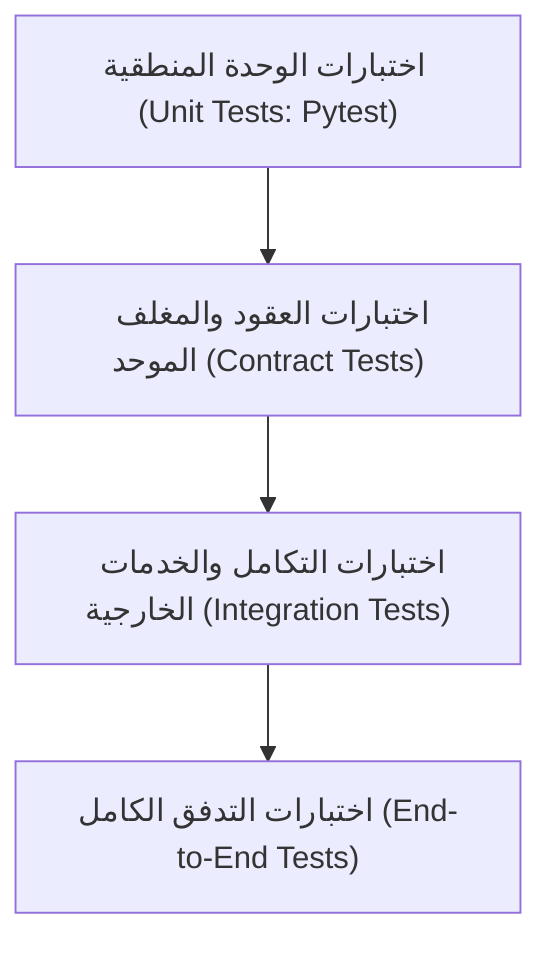

# 🧪 استراتيجية الاختبار وضمان الجودة (Test Strategy)
**تاريخ الاعتماد:** 28 أكتوبر 2026  
**المرجعية:** معايير التنفيذ F4 وبوابة الجودة F3

---

## 🎯 1. طبقات الاختبار المعتمدة في المنظومة

1. **اختبارات الوحدة (Unit Tests):** فحص منطق الأعمال، دوال التحقق (`validators.py`)، وفئات الأخطاء الـ 12.
2. **اختبارات العقود (Contract Tests):** التحقق من سلامة البيانات العابرة عبر `RequestEnvelope` و `ResponseEnvelope` وضمان عدم تسريب الحقول السرية.
3. **اختبارات المحاكاة (Mocked Integration Tests):** اختبار محولات الذكاء والمنصات باستخدام بيئات محاكاة (Mocks) لعزل التكلفة وتسريع وقت الاختبار في الـ CI.
4. **اختبارات الإنتاج الحية (Live Smoke Tests):** اختبارات مقننة ومحدودة على استدعاءات حقيقية للمزودين (مثل اختبار Groq Live الناجح في الشريحة الأولى).
