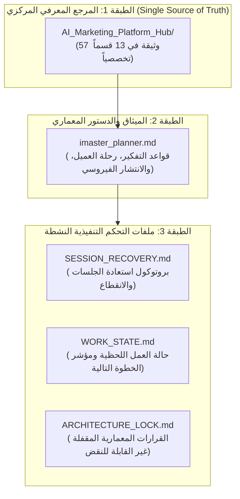

# 🚀 AI Marketing Platform (AI Growth OS)

> **منظومة التسويق الرقمي التكيفية بالذكاء الاصطناعي — المستودع المركزي للمشروع ومركز توجيه وكلاء الذكاء الاصطناعي والمطورين.**

---

## 🎯 المهمة النهائية للمنتج (Product Vision)

بناء منصة تسويق إلكتروني شاملة ومستقلة بالذكاء الاصطناعي تستهدف خدمة مختلف الأنشطة التجارية (الشركات، المتاجر الإلكترونية، العيادات، المصانع، العقارات، والمطاعم، ووكالات التسويق).

المنظومة مصممة لتقليل الاحتكاك البشري إلى أقصى حد ممكن من خلال:
1. **ربط القنوات بضغطة زر** (Meta, TikTok, WhatsApp, Google Business, Shopify, Salla).
2. **بناء عقل العلامة التجارية التراكمي (Brand Brain)** وفهم نبرة الصوت والمنتجات والجمهور.
3. **التشخيص القائم على الأدلة (Evidence-Based Diagnosis)** عبر 12 بُعداً تجارياً.
4. **توليد خطط نمو أسبوعية ديناميكية** وإعداد المحتوى الإبداعي (نصوص، صور، فيديو).
5. **بوابة اعتماد وتحكم بشري إلزامية (Human-in-the-Loop)** لحماية سمعة العميل وميزانيته.
6. **تنفيذ مؤتمت وقياس أثر حقيقي مغلق** يربط الإجراء بالنتائج المالية ونمو المبيعات.

---

## 🏛️ هيكلية الحوكمة وإدارة المستودع (3-Tier Governance)

يعمل هذا المستودع وفق نموذج تحكم ثلاثي المستويات يمنع فقدان المعرفة ويضمن دقة التنفيذ:

- **المرجع المعرفي المركزي:** [`AI_Marketing_Platform_Hub/`](./AI_Marketing_Platform_Hub/00_START_HERE/MASTER_INDEX.md) يضم التوثيق الكامل من متطلبات، دراسة جدوى، أبحاث مفتوحة المصدر، وخطط تنفيذ.
- **الميثاق المعماري:** [`imaster_planner.md`](./imaster_planner.md) يحكم دورة عمل المخطط والوكيل المنفذ والمالك.
- **ملفات التحكم اللحظية:**
  - [`SESSION_RECOVERY.md`](./SESSION_RECOVERY.md): بروتوكول استئناف العمل الآمن بعد الانقطاع.
  - [`WORK_STATE.md`](./WORK_STATE.md): المهمة النشطة الحالية، رقم الكوميت، ونتائج الاختبارات.
  - [`ARCHITECTURE_LOCK.md`](./ARCHITECTURE_LOCK.md): القرارات المقفلة التي لا يجوز تجاوزها (D-001 إلى D-055).

---

## 🗺️ خريطة المرجع المركزي (Knowledge Hub Navigation)

| القسم | الرابط | المحتوى الأساسي |
|---|---|---|
| **00. البداية** | [00_START_HERE](./AI_Marketing_Platform_Hub/00_START_HERE/) | الدليل السريع، حالة المشروع العامة، والفهرس الشامل |
| **01. الاستكشاف** | [01_PROJECT_DISCOVERY](./AI_Marketing_Platform_Hub/01_PROJECT_DISCOVERY/) | جرد المصادر السابقة، تدقيق الأصول، والفجوات المعرفية |
| **02. المتطلبات** | [02_REQUIREMENTS_AND_VISION](./AI_Marketing_Platform_Hub/02_REQUIREMENTS_AND_VISION/) | رؤية المنتج، المشاكل، شرائح العملاء، والمتطلبات الوظيفية |
| **03. الإنجاز السابق** | [03_EXISTING_PROGRESS](./AI_Marketing_Platform_Hub/03_EXISTING_PROGRESS/) | ما تم إنجازه، الأصول القابلة للاستخدام، والمشكلات المعلومة |
| **04. المعمارية** | [04_ARCHITECTURE_AND_DESIGN](./AI_Marketing_Platform_Hub/04_ARCHITECTURE_AND_DESIGN/) | المونوليث المعياري، استراتيجية الذكاء الاصطناعي، وعقود البيانات |
| **05. الأبحاث المفتوحة** | [05_OPEN_SOURCE_RESEARCH](./AI_Marketing_Platform_Hub/05_OPEN_SOURCE_RESEARCH/) | كتالوج المصادر المفتوحة، تقييم التراخيص، ودراسة المنافسين |
| **06. تخطيط المنتج** | [06_PRODUCT_PLANNING](./AI_Marketing_Platform_Hub/06_PRODUCT_PLANNING/) | نطاق المنتج، مواصفات MVP، وتدفقات المستخدمين |
| **07. التنفيذ والاختبار**| [07_EXECUTION_AND_TESTING](./AI_Marketing_Platform_Hub/07_EXECUTION_AND_TESTING/) | خطة التنفيذ، سجل المهام، استراتيجية الاختبار، ومعايير الجودة |
| **08. الأمان والتشغيل** | [08_SECURITY_AND_OPERATIONS](./AI_Marketing_Platform_Hub/08_SECURITY_AND_OPERATIONS/) | معايير الأمان، حماية الخصوصية، والتكاليف وقابلية التوسع |
| **09. نموذج الأعمال** | [09_BUSINESS_AND_GO_TO_MARKET](./AI_Marketing_Platform_Hub/09_BUSINESS_AND_GO_TO_MARKET/) | دراسة الجدوى المالية، الباقات، دورات الانتشار الفيروسي، والولاء |
| **10. سجل القرارات** | [10_DECISIONS_AND_HISTORY](./AI_Marketing_Platform_Hub/10_DECISIONS_AND_HISTORY/) | سجل القرارات الرسمية (D-001 إلى D-055)، والمخاطر المعمارية |
| **11. التسليم والاستلام**| [11_HANDOVER](./AI_Marketing_Platform_Hub/11_HANDOVER/) | دليل تسليم الوكلاء، والأسئلة المفتوحة، والخطوات التالية |
| **12. الأرشيف** | [12_ARCHIVE_INDEX](./AI_Marketing_Platform_Hub/12_ARCHIVE_INDEX/) | فهرس ومسارات الملفات الأرشيفية السابقة |

---

## 🛠️ البنية التقنية الأساسية (Core Tech Stack)

- **Backend:** Python 3.12+ / FastAPI / Pydantic v2 (Modular Monolith)
- **Database:** PostgreSQL 16+ مع `pgvector`
- **Frontend:** Next.js 14 / React / Tailwind CSS (دعم كامل للعربية و RTL)
- **AI Gateway:** LiteLLM Proxy (OpenAI, Anthropic, Gemini, Groq, Ollama)
- **Workflows:** Temporal Server (Durable Execution)
- **Messaging:** WhatsApp Cloud API / Meta Graph API / TikTok API
- **Testing:** Pytest / Playwright (Unit, Integration, Contract tests)

---

## 🔒 القواعد الحاكمة غير القابلة للتفاوض (Non-Negotiable Rules)

1. **Evidence Before Claims:** كل ميزة أو تشخيص يستند إلى دليل رقمي مؤكد؛ ممنوع اختلاق أرقام أو وعود تسويقية وهمية.
2. **Human in the Loop:** لا منشور يُنشر ولا رسالة تُرسل دون اعتماد صريح من العميل.
3. **No AGPL in Core:** ممنوع نهائياً دمج أي كود خاضع لرخصة AGPL في النواة التجارية للمنظومة (D-054).
4. **No Secrets in Repo:** ممنوع وضع أي مفاتيح API أو توكنات داخل المستودع؛ استخدم `.env` والبيئة المشفرة دائماً.

---

## 🚦 حالة التطوير الحالية والخطوة التالية (Current Status)

المستودع مهيأ بالكامل وموثق بـ 57 وثيقة معتمدة وميثاق معماري شامل.
الخطوة التنفيذية النشطة المحددة في [`WORK_STATE.md`](./WORK_STATE.md) هي:
**المرحلة 0 و 1 (Phase 0 & 1):** تأسيس هيكل تطبيق FastAPI الموحد وبناء تكامل منصات التواصل الاجتماعي الرسمية (**Meta Graph API / Facebook & Instagram**).
